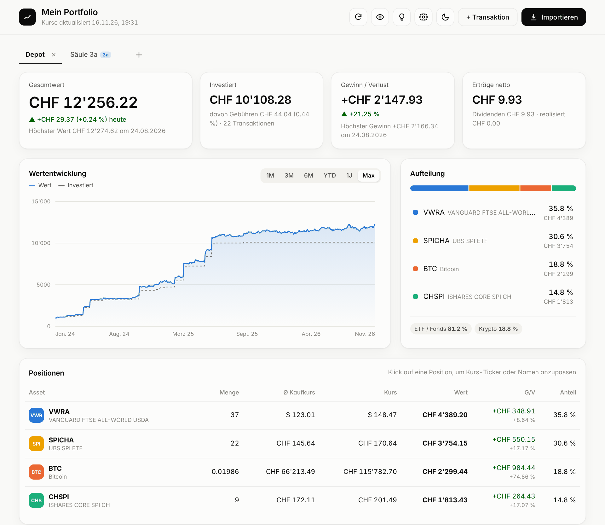
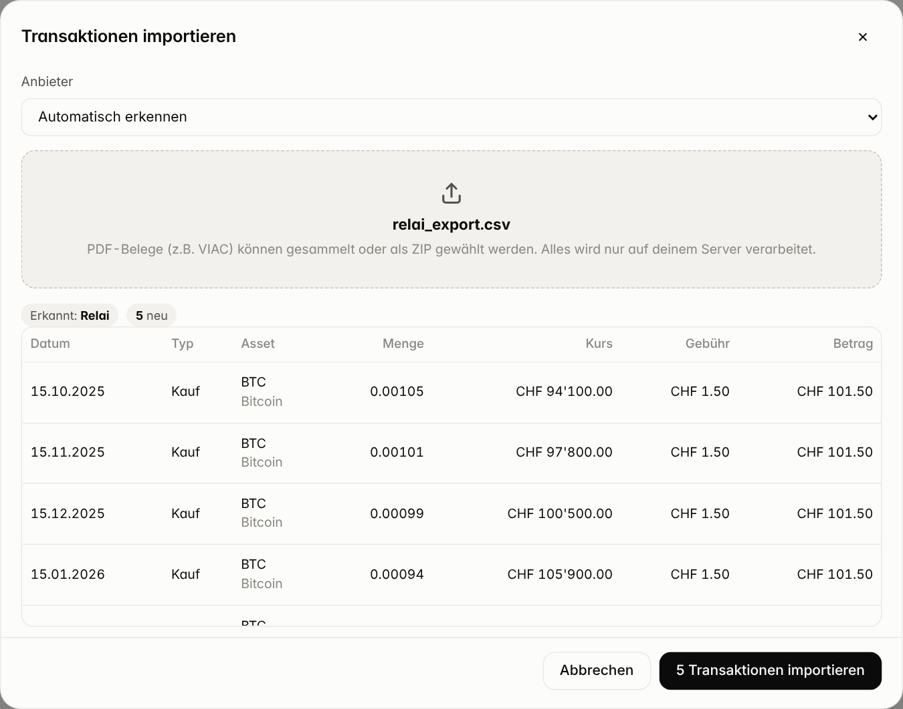
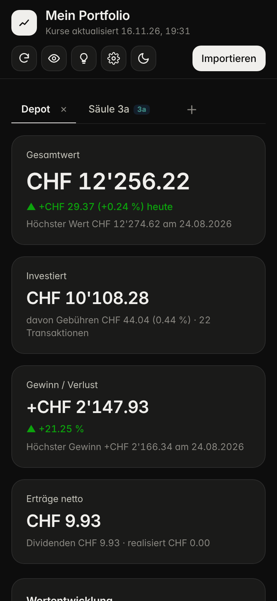
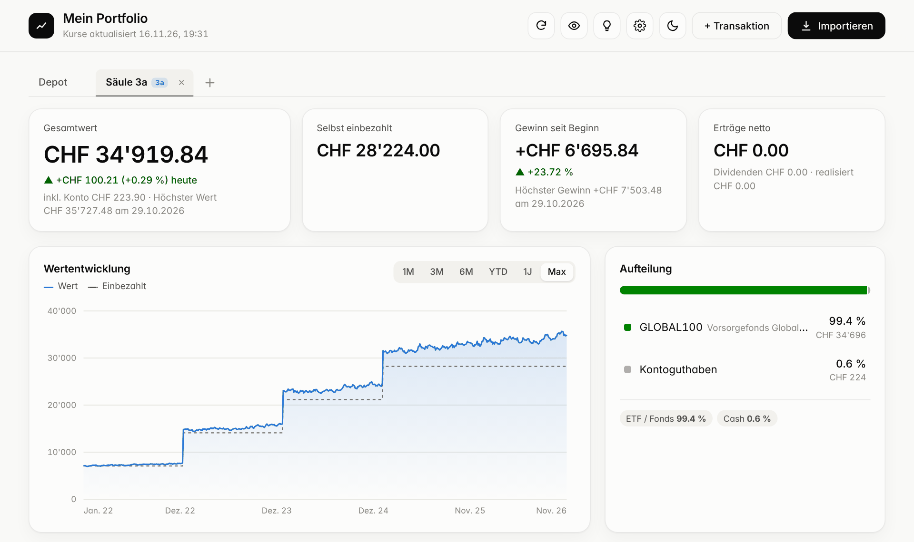
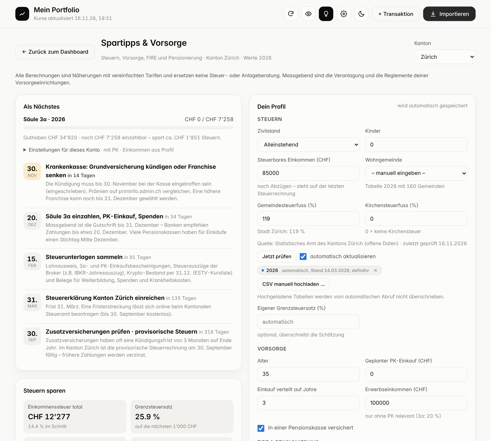
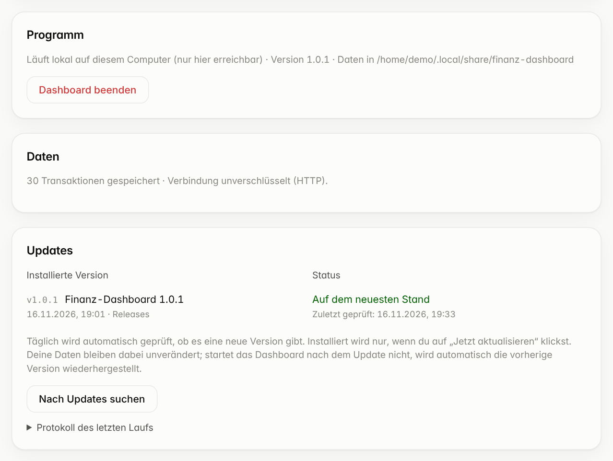

# Finanz-Dashboard

[English](README.md) | **Deutsch**

Schlankes, selbst gehostetes Portfolio-Dashboard – lokal auf deinem Computer (Windows, macOS, Linux)
oder auf einem eigenen Server bzw. im Proxmox-Homelab.
Importiert CSV-Exporte von **Relai** (Bitcoin) und **Interactive Brokers** (ETFs/Aktien) sowie beliebige andere CSVs per Spalten-Zuordnung.

- Keine externen Python-Pakete – nur Python 3 + SQLite
- Live-Kurse und Wechselkurse über Yahoo Finance (ohne API-Key), automatisch alle 4 h
- Bewertung in Basiswährung (Standard CHF), Kostenbasis nach Durchschnittskosten-Methode
- Duplikat-Erkennung: dieselbe Datei (oder IBKR-Statement + Flex Query) kann mehrfach importiert werden
- Hell/Dunkel-Modus, funktioniert auch auf dem Handy
- Spartipps & Vorsorge: Steuer-Schätzung, 3a-Stand, FIRE-/Pensionsrechner und Fristen (Kanton Zürich)

Weitere Funktionen folgen, z.B. Importe von weiteren Brokern und 3a-Anbietern. Probleme oder Wünsche bitte als
[Issue](https://github.com/Kevegl/finance-dashboard/issues) melden, siehe [Probleme & Wünsche](#probleme--wünsche).

<picture>
  <source media="(prefers-color-scheme: dark)" srcset="docs/screenshots/dashboard-dunkel.png">
  
</picture>

<sub>Alle Werte in den Bildern sind erfunden (Beispieldaten aus <code>beispiel-csv/</code>).</sub>

## So funktioniert's

1. **Exporte herunterladen** – bei Relai, Interactive Brokers, Finpension oder VIAC die Transaktionen als CSV
   bzw. die PDF-Belege speichern. Bei anderen Anbietern geht jede CSV-Datei.
2. **Importieren** – Datei ins Dashboard ziehen. Es erkennt den Anbieter, zeigt eine Vorschau und überspringt
   Einträge, die schon vorhanden sind. Erst mit dem Klick auf *Importieren* wird etwas gespeichert.
3. **Überblick behalten** – Kurse und Wechselkurse werden automatisch aktualisiert. Oben siehst du Gesamtwert,
   investiertes Geld und Gewinn, darunter die Entwicklung über die Zeit, die Aufteilung und alle Positionen.

<table>
  <tr>
    <td width="62%" valign="top"></td>
    <td valign="top"></td>
  </tr>
  <tr>
    <td><b>Import:</b> Anbieter wird erkannt, Vorschau vor dem Speichern, Duplikate werden übersprungen.</td>
    <td><b>Handy:</b> passt sich an kleine Bildschirme an, hell oder dunkel.</td>
  </tr>
</table>

**Mehrere Portfolios und Säule 3a** – jedes Konto bekommt einen eigenen Reiter. Bei 3a-Konten rechnet das
Dashboard mit den Einzahlungen: *Selbst einbezahlt* gegenüber *Gesamtwert*, inklusive Kontoguthaben.



**Spartipps & Vorsorge** (Glühbirne oben rechts) – Fristen der nächsten Monate, wie viel 3a-Einzahlungen und
PK-Einkäufe an Steuern sparen, Gemeindevergleich sowie ein FIRE- und Pensionsrechner. Die Angaben im Profil
werden nur in deinem Dashboard gespeichert.



**Einstellungen → Programm und Updates** – zeigt Version und Datenordner, prüft täglich auf neue Versionen und
installiert sie per Klick. Startet eine neue Version nicht, kehrt das Dashboard automatisch zur bisherigen zurück.



## Welche Variante passt zu mir?

| Du hast …                                   | Empfehlung                                                   | Updates                         |
|---------------------------------------------|--------------------------------------------------------------|---------------------------------|
| einen Windows-PC oder Mac, keine Technik-Lust | [**Programm** herunterladen](#programm-windows--mac)         | per Klick im Dashboard          |
| Windows, Mac oder Linux mit Python           | [**Python-Variante**](#python-variante-windows-mac-linux)    | per Klick im Dashboard          |
| ein NAS (Synology, QNAP), Raspberry Pi, Docker | [**Docker**](#docker-nas-raspberry-pi)                       | `docker compose pull`           |
| einen Proxmox-Server / Linux-Server          | [**Proxmox (LXC)**](#installation-auf-proxmox-lxc)           | per Klick im Dashboard          |

Bei den ersten beiden Varianten läuft das Dashboard nur auf deinem Computer (`http://127.0.0.1:8765`) und ist
im Netzwerk nicht erreichbar. Sie brauchen weder eine Installation noch Administratorrechte. Server und Docker
sind dafür auch vom Handy aus erreichbar, zu Hause oder per VPN.

## Programm (Windows & Mac)

1. Auf GitHub unter [**Releases**](https://github.com/Kevegl/finance-dashboard/releases/latest) die passende Datei
   herunterladen:
   - Windows: `FinanzDashboard-<version>-windows-x64.zip`
   - Mac mit Apple-Chip (M1 oder neuer): `FinanzDashboard-<version>-macos-arm64.zip`. Für ältere Intel-Macs
     die [Python-Variante](#python-variante-windows-mac-linux) verwenden.
2. Die ZIP-Datei entpacken, z.B. in *Dokumente* (Windows) bzw. in *Programme* (Mac).
3. **Starten:**
   - Windows: `FinanzDashboard.exe` doppelklicken. Beim ersten Start warnt Windows («Der Computer wurde durch
     Windows geschützt»), weil das Programm nicht kostenpflichtig signiert ist. Klicke dann auf
     *Weitere Informationen → Trotzdem ausführen*.
   - Mac: `FinanzDashboard.app` mit *Rechtsklick → Öffnen* starten. Erscheint stattdessen nur eine Warnung:
     *Systemeinstellungen → Datenschutz & Sicherheit → Dennoch öffnen*. Das ist nur beim ersten Mal nötig.
4. Der Browser öffnet sich. Beim ersten Aufruf legst du Benutzername und Passwort fest.

Solange das Dashboard läuft, zeigt ein kleines **Statusfenster** «Finanz-Dashboard – Läuft auf diesem Computer»
mit den Knöpfen *Im Browser öffnen* und *Beenden*. Es bleibt in der Taskleiste bzw. im Dock, auch wenn du den
Browser schliesst, und lässt sich minimieren. Schliesst du das Fenster, wird das Dashboard beendet. Beenden geht
auch im Dashboard unter *Einstellungen → Programm → Dashboard beenden*. Klickst du das Programm erneut an, während
es schon läuft, öffnet sich nur der Browser. Meldungen zur Fehlersuche stehen in `local/launcher.log` im
Datenordner (siehe unten).

## Python-Variante (Windows, Mac, Linux)

1. **Python 3.10 oder neuer** installieren, falls noch nicht vorhanden:
   [python.org/downloads](https://www.python.org/downloads/). Unter Windows dabei *Add python.exe to PATH* anhaken.
   Unter Linux ist Python meist schon installiert.
2. Auf GitHub unter [**Releases**](https://github.com/Kevegl/finance-dashboard/releases/latest) bei der neuesten
   Version *Source code (zip)* herunterladen und entpacken.
3. **Starten** per Doppelklick:
   - Windows: `start.bat`
   - macOS: `start.command`. Beim ersten Mal *Rechtsklick → Öffnen*, weil die Datei aus dem Internet stammt.
   - Linux: `./start.sh` im Terminal

   Es öffnen sich ein Konsolenfenster, das kleine Statusfenster (wie beim Programm, siehe oben) und der Browser.
   Unter Linux erscheint das Statusfenster nur, wenn `python3-tk` installiert ist, sonst bleibt nur die Konsole.

**Beenden:** *Beenden* im Statusfenster, *Einstellungen → Programm → Dashboard beenden* oder `Strg+C` im
Konsolenfenster.

### Daten, Updates und Passwort (Programm und Python-Variante)

**Deine Daten** liegen getrennt vom Programm im Benutzerprofil. Programm und Python-Variante benutzen
denselben Ordner, du kannst also jederzeit wechseln:

| System  | Datenordner |
|---------|-------------|
| Windows | `%LOCALAPPDATA%\FinanzDashboard` |
| macOS   | `~/Library/Application Support/FinanzDashboard` |
| Linux   | `~/.local/share/finanz-dashboard` |

Den Programm- bzw. Download-Ordner kannst du jederzeit löschen oder ersetzen, deine Daten bleiben erhalten.
Lade trotzdem ab und zu unter *Einstellungen → Sicherung* eine Sicherung herunter.
Mit der Umgebungsvariable `FD_DATA_DIR` lässt sich ein anderer Datenordner wählen, mit `FD_PORT` ein anderer Port.

**Updates:** Das Dashboard prüft einmal täglich bei GitHub, ob es eine neue Version gibt. Ein Punkt am Zahnrad
zeigt an, dass ein Update bereitliegt.
- Installiert wird nur auf Klick unter *Einstellungen → Updates*. Das Dashboard lädt die neue Version in den
  Datenordner, startet neu und prüft, ob sie läuft. Startet sie nicht, kehrt es automatisch zur bisherigen
  Version zurück. Zusätzlich gibt es den Button *Vorherige Version wiederherstellen*.
- Lädst du von Hand einen neueren Download herunter, wird automatisch dieser verwendet.

**Passwort vergessen?** Ein neues Passwort legst du mit deinem **Wiederherstellungscode** fest
(siehe [Sicherheit](#sicherheit)): auf der Anmeldeseite *Passwort vergessen?* wählen oder im **Statusfenster**
*Passwort vergessen …* → *Mit Wiederherstellungscode …*.

Ohne Wiederherstellungscode bleibt nur ein **Neubeginn**: Statusfenster → *Passwort vergessen …* → *Neu beginnen –
alle Daten löschen …* und mit `ENTFERNEN` bestätigen. Alle Portfolios, Transaktionen und Einstellungen werden endgültig
gelöscht, danach startet ein leeres Dashboard. So kann niemand, der an deinem entsperrten Computer sitzt, deine Daten
mit einem eigenen Passwort öffnen.

> Wirksamen Schutz vor Personen mit Zugang zu deinem Computer bietet dein Computer-Konto: Bildschirm sperren,
> Windows-/macOS-Passwort oder Windows Hello/Touch ID verwenden und die Laufwerksverschlüsselung (BitLocker/FileVault)
> einschalten.

## Docker (NAS, Raspberry Pi)

Fertiges Image für amd64 und arm64 (Raspberry Pi 4/5, die meisten NAS): `ghcr.io/kevegl/finance-dashboard`.
Lade [`docker-compose.yml`](docker-compose.yml) herunter und starte es:

```bash
docker compose up -d
```

Danach ist das Dashboard unter `http://<Adresse-des-Geräts>:8080` erreichbar. Auf einem Synology-NAS geht das
auch über *Container Manager → Projekt → Erstellen* mit dieser Datei. Die Daten liegen im Volume `fd-data`.
Für die Ersteinrichtung braucht es den **Einrichtungscode** aus dem Protokoll des Containers:
`docker logs finance-dashboard` (Zeile «Einrichtungscode für die Ersteinrichtung: XXXX-XXXX»).

**Updates:** Das Dashboard zeigt unter *Einstellungen → Updates* an, wenn es eine neue Version gibt. Installiert
wird mit:

```bash
docker compose pull && docker compose up -d
```

Alternativ automatisch mit [Watchtower](https://containrrr.dev/watchtower/).

Docker läuft ohne HTTPS. Mach es deshalb nur im Heimnetz oder per VPN erreichbar und richte keine
Portweiterleitung im Router ein. Passwort vergessen: auf der Anmeldeseite mit dem Wiederherstellungscode
(siehe [Sicherheit](#sicherheit)) oder, ohne Code, mit:

```bash
docker exec finance-dashboard python3 server.py --reset-password
```

## Installation auf Proxmox (LXC)

1. **Container anlegen** (auf dem Proxmox-Host, Debian-12-Template):
   ```bash
   pveam update && pveam download local debian-12-standard_12.7-1_amd64.tar.zst
   ID=120   # freie Container-ID auf deinem Proxmox-Host
   pct create $ID local:vztmpl/debian-12-standard_12.7-1_amd64.tar.zst \
     --hostname finance --cores 1 --memory 512 --rootfs local-lvm:4 \
     --net0 name=eth0,bridge=vmbr0,ip=dhcp --unprivileged 1 --features nesting=1 --start 1
   ```
   (ID, Storage und Template-Version an dein System anpassen – `pveam available | grep debian` zeigt die aktuelle Version.)

2. **Code holen** und installieren (im Container):
   ```bash
   pct enter $ID
   apt update && apt install -y git
   git clone https://github.com/Kevegl/finance-dashboard.git /root/finance-dashboard
   cd /root/finance-dashboard && bash install.sh
   ```

3. Im Browser öffnen: `https://<IP-des-Containers>:8080` (Zertifikatswarnung einmalig bestätigen)

### Einstellungen
In `/etc/finance-dashboard.env`, danach `systemctl restart finance-dashboard`:

| Variable | Bedeutung | Standard |
|---|---|---|
| `FD_PORT` | Port | `8080` |
| `FD_BASE_CCY` | Start-Basiswährung (danach in den Einstellungen änderbar) | `CHF` |
| `FD_PRICE_TTL` | Kurs-Aktualisierung in Sekunden | `14400` |

**Sicherheit:** `install.sh` aktiviert automatisch **HTTPS** (selbstsigniertes Zertifikat). Beim **ersten Aufruf** legst du im Browser Benutzername und Passwort fest; dafür braucht es den **Einrichtungscode**, den `install.sh` am Ende anzeigt (auch in `/var/lib/finance-dashboard/setup-code.txt` und `journalctl -u finance-dashboard`) (gespeichert als PBKDF2-Hash, Anmeldung per sicherem Sitzungs-Cookie, 30 Tage gültig). Passwort ändern, andere Geräte abmelden und CSV-Export findest du unter **Einstellungen** (Zahnrad oben rechts). Nach 5 falschen Passwörtern wird die IP 15 Minuten gesperrt.
Passwort vergessen: auf der Anmeldeseite mit dem Wiederherstellungscode. Ohne Code im Container
`cd /opt/finance-dashboard/app && FD_DATA_DIR=/var/lib/finance-dashboard python3 server.py --reset-password`, danach
erscheint wieder die Ersteinrichtung. Weitere Schutzmassnahmen stehen unter [Sicherheit](#sicherheit).
Von aussen nur über VPN (WireGuard/Tailscale) erreichbar machen, keine Portweiterleitung im Router.

**Sicherung:** Unter *Einstellungen → Sicherung & Wiederherstellung* lädst du eine JSON-Datei mit allen Portfolios, Transaktionen, Ticker-Einstellungen und der Kurshistorie herunter (ohne Passwort). Nach einer Neuinstallation: Zugang einrichten → Sicherung wiederherstellen. Zusätzlich empfohlen: den Container in den Proxmox-Backup-Job aufnehmen.

**Mehrere Portfolios:** Über die Tabs oben im Dashboard (+ = neues Portfolio, Doppelklick = umbenennen). Jedes Portfolio hat eigene Transaktionen und Importe; verwalten/löschen unter *Einstellungen → Portfolios*.

**Update:** am einfachsten im Dashboard unter *Einstellungen → Updates* (siehe unten). Alternativ im Container: `cd /root/finance-dashboard && git pull && bash install.sh` (Daten und Einstellungen bleiben erhalten – sie liegen ausserhalb des Repos in `/var/lib/finance-dashboard` und `/etc/finance-dashboard.env`).

## Updates im Dashboard (Proxmox)

Wurde das Dashboard per `git clone` installiert, richtet `install.sh` zusätzlich einen kleinen Update-Dienst ein.
Unter *Einstellungen → Updates* siehst du dann die installierte Version, ob es eine neue gibt (mit Änderungsliste)
und kannst sie per Klick installieren. Ein Punkt am Zahnrad zeigt an, dass ein Update bereitliegt.

- **Tägliche Prüfung:** Ein systemd-Timer prüft einmal am Tag, ob es eine neue Version gibt. Installiert wird nur auf Klick.
- **Kanal** (`FD_UPDATE_CHANNEL` in `/etc/finance-dashboard.env`): Mit `release` gibt es nur veröffentlichte
  Versionen (Git-Tags `v1.2.3`). Das ist der Standard bei Neuinstallationen. Mit `main` ist jeder neue Commit ein
  Update. Ohne Eintrag gilt `main`, so verhalten sich bestehende Installationen wie bisher.
- **Sicherheit:** Das Dashboard läuft als eingeschränkter Benutzer und schreibt beim Klick nur eine Auftragsdatei.
  Ausgeführt wird sie vom root-Dienst `finance-dashboard-update`, der ausschliesslich `check`, `update` und `rollback`
  akzeptiert, nur Fast-Forward-Updates aus dem eigenen Repository holt und lokale Änderungen nie überschreibt.
- **Signaturprüfung (empfohlen):** Weil `install.sh` beim Update als root läuft, könnte ein fremder Push auf GitHub
  (gestohlenes Konto oder Token) Code im Container ausführen. Mit einer Liste erlaubter Schlüssel installiert der
  Dienst nur Versionen, die mit deinem eigenen SSH-Schlüssel signiert sind – siehe [Signierte Updates](#signierte-updates).
- **Automatischer Rollback:** Antwortet das Dashboard nach dem Update nicht, wird die vorherige Version wiederhergestellt.
  Zusätzlich gibt es den Button *Vorherige Version wiederherstellen*.
- Im Container von Hand: `finance-dashboard-update check | update | rollback`, Status in
  `/var/lib/finance-dashboard-update/status.json`, Timer: `systemctl list-timers finance-dashboard-update-check.timer`.

### Signierte Updates

Einmalig auf deinem eigenen Computer einen Signaturschlüssel anlegen und Git sagen, dass er Tags damit signiert:

```bash
ssh-keygen -t ed25519 -f ~/.ssh/finance_release -C "finance-dashboard release"
```

```bash
git config --global gpg.format ssh && git config --global user.signingkey ~/.ssh/finance_release.pub
```

Im Container die Datei `/etc/finance-dashboard/allowed_signers` anlegen (eine Zeile pro erlaubtem Schlüssel, Inhalt
von `~/.ssh/finance_release.pub` einsetzen) und den Kanal auf `release` stellen:

```bash
echo 'release namespaces="git" ssh-ed25519 AAAA…dein-öffentlicher-Schlüssel…' > /etc/finance-dashboard/allowed_signers
```

```bash
sed -i 's/^FD_UPDATE_CHANNEL=.*/FD_UPDATE_CHANNEL=release/' /etc/finance-dashboard.env && grep -q '^FD_UPDATE_CHANNEL=' /etc/finance-dashboard.env || echo 'FD_UPDATE_CHANNEL=release' >> /etc/finance-dashboard.env
```

Ab dann installiert der Update-Dienst nur noch Releases, deren Tag mit diesem Schlüssel signiert ist
(`git tag -s v1.2.3 -m "…"`, siehe [Neue Version veröffentlichen](#neue-version-veröffentlichen)). Ein unsigniertes
Release zeigt *Einstellungen → Updates* als «Nicht installierbar» an. Auf dem Kanal `main` muss entsprechend der
neueste Commit signiert sein. Ohne die Datei bleibt die Prüfung aus (bisheriges Verhalten). Anderer Pfad:
`FD_UPDATE_SIGNERS=/pfad/zur/datei` in `/etc/finance-dashboard.env`.

Hinweis: Die Prüfung betrifft die Proxmox-Installation mit Update-Dienst. Programm, Python-Variante und Docker laden
Releases über HTTPS direkt von GitHub.

**Privates Repository** (nur bei einem eigenen, privaten Fork): Der Container braucht einen Lesezugriff, am besten einen Deploy Key:
```bash
ssh-keygen -t ed25519 -f ~/.ssh/finance_deploy -N "" -C "finance-lxc"
printf 'Host github.com\n  IdentityFile ~/.ssh/finance_deploy\n  IdentitiesOnly yes\n' >> ~/.ssh/config
cat ~/.ssh/finance_deploy.pub   # auf GitHub: Repo → Settings → Deploy keys → Add (ohne Schreibzugriff)
git clone git@github.com:Kevegl/finance-dashboard.git /root/finance-dashboard
```

## CSV exportieren

**Relai:** App → *Transaktionen* → Pfeil oben rechts → Zeitraum wählen → Format *CSV*.
Käufe und Verkäufe werden übernommen; Auszahlungen in die eigene Wallet werden übersprungen (der BTC gehört dir ja weiterhin).

**Interactive Brokers** – zwei Varianten, beide werden automatisch erkannt:
- *Activity Statement*: Client Portal → Performance & Berichte → Kontoauszüge → *Aktivität* → Zeitraum wählen → Format **CSV**. Enthält auch Dividenden und die Börse (für automatische Kurs-Ticker).
- *Flex Query*: Performance & Berichte → Flex Queries → Aktivität-Flex-Query mit Sektion *Trades* (Felder u.a. Symbol, TradeDate, Quantity, TradePrice, CurrencyPrimary, IBCommission, Buy/Sell, ListingExchange) → Format CSV.

Tipp: Bei IBKR das Statement für ein ganzes Jahr bzw. seit Kontoeröffnung exportieren. Devisentausch-Trades (z.B. CHF→USD) werden übersprungen.

**Andere Anbieter** (Swissquote, PostFinance, Yuh, …): Im Import-Dialog *Anderer Anbieter* wählen und die Spalten (Datum, Asset, Menge, Kurs, Betrag …) zuordnen.

## Kurse & Ticker
Beim Import wird der Yahoo-Ticker automatisch gesetzt, wenn möglich (BTC → `BTC-CHF`, IBKR mit Börse LSE → `VWRA.L`, SIX → `CHSPI.SW` …).
Fehlt ein Ticker, wird mit dem letzten Kaufkurs bewertet – ein Hinweis erscheint oben. Klick auf die Position, um den Ticker zu setzen oder einen manuellen Kurs einzutragen.
Endungen: `.SW` SIX, `.L` London, `.DE` Xetra, `.AS` Amsterdam, `.PA` Paris, ohne Endung = USA.

Der Container braucht dafür Internetzugang zu `query1.finance.yahoo.com`.

## Säule 3a: Finpension und VIAC

- **Finpension:** Transaktionsreport als CSV exportieren und importieren (wird automatisch erkannt).
- **VIAC:** bietet keinen CSV-Export – stattdessen die PDF-Belege importieren (mehrere PDFs auf einmal oder als ZIP).
  Erkannt werden Börsenabrechnungen (Kauf/Verkauf), Ausschüttungen, Zinsen und Verwaltungsgebühren.
- Ein-/Auszahlungen und Transfers zwischen Stiftungen sind reine Geldbewegungen und werden übersprungen.
- Zinsen und Kontogebühren laufen über die Position „CASH“ und fliessen in „Erträge netto“ ein.
- Die Fonds haben meist keinen Yahoo-Kurs – bewertet wird mit dem letzten Kauf-/Verkaufskurs (bei monatlichen
  Käufen recht aktuell) oder einem manuellen Kurs (Position anklicken).
- Der PDF-Import braucht `pdftotext` (Paket `poppler-utils`, wird von install.sh installiert).

## Spartipps & Vorsorge

Über das Glühbirnen-Symbol oben (oder `#/vorsorge`) öffnet sich eine eigene Ansicht:

- **Als Nächstes:** kommende Fristen nach Datum (Krankenkasse 30.11., 3a/PK-Einkauf bis Jahresende,
  Steuererklärung …) und wie viel du dieses Jahr noch in die Säule 3a einzahlen kannst – gezählt werden die
  Einzahlungen in deinen 3a-Portfolios.
- **Steuern sparen:** Schätzung von Einkommenssteuer, Grenzsteuersatz und Ersparnis durch 3a-Einzahlung,
  3a-Nachzahlung und PK-Einkauf (einmalig vs. gestaffelt). Den Grenzsteuersatz aus der eigenen Steuerrechnung kannst du
  direkt eintragen.
- **Gemeindesteuerfüsse:** Für den Kanton Zürich holt der Server die aktuellen Steuerfüsse automatisch (höchstens
  einmal täglich) aus den offenen Daten des Statistischen Amts (`www.web.statistik.zh.ch`, Datensatz «Steuerfüsse der
  Zürcher Gemeinden» auf opendata.swiss). Neue Jahre erscheinen, sobald der Kanton sie publiziert; im Profil lässt sich
  der Abruf auslösen oder abschalten. Alternativ die CSV manuell hochladen (das Jahr wird aus dem Dateinamen gelesen,
  hochgeladene Tabellen werden vom Abruf nicht überschrieben). Danach Wohngemeinde und
  Konfession wählen; Gemeinden mit mehreren Steuerfüssen (Schul-/Kirchgemeinden) bieten eine Variantenauswahl.
  Zusätzlich gibt es einen Vergleich mit den günstigsten und teuersten Gemeinden.
- **Mehrere 3a-Konten:** z.B. eigenes und Partner-Konto einzeln anzeigen oder vergleichen; pro Konto lassen sich
  PK-Anschluss, Erwerbseinkommen und steuerbares Einkommen festlegen.
- **FIRE & Pensionierung:** FIRE-Zahl, frühestes Ausstiegsalter, Brücke bis 65 inkl. AHV-Beiträgen als
  Nichterwerbstätige und Rentenlücke. Das Vermögen wird aus den Portfolios übernommen (überschreibbar).
- **Tipps & Tricks:** rund 45 Tipps zu Steuern, Vorsorge, Anlegen, Alltag, FIRE, Pensionierung und anstehenden
  Gesetzesänderungen – mit persönlichen Zahlen aus dem Profil und zum Abhaken.

**Jahreswechsel:** 3a-Einzahlungen und Fristen beziehen sich immer auf das laufende Jahr. Jährliche Tipps
(3a, Krankenkasse, Abzüge …) sind am 1. Januar wieder offen, einmalige bleiben erledigt; befristete Tipps verschwinden
nach ihrem Gültigkeitsjahr. Amtliche Jahreswerte (AHV-Maximalrente, 3a-Maximum, Bundestarif) stehen in
`YEAR_VALUES`/`FED_BY_YEAR` in `app/static/plan.js` und kommen per Update. Fehlen sie für ein neues Jahr, gelten die
Werte des Vorjahres mit einem Hinweis – dort lässt sich die neue AHV-Maximalrente eintragen, die 3a-Maximalbeträge
(24 % bzw. 120 % der jährlichen Maximalrente) werden daraus berechnet.

Das Profil wird auf dem Server gespeichert (in der Datenbank, also auch in der Sicherung). Alle Tarife sind
Näherungen (Bundessteuer nach amtlichem Tarif 2026, Staatssteuer vereinfacht) und ersetzen keine Beratung. Weitere Kantone lassen sich in `app/static/plan.js`
(`CANTONS`, `DEADLINES`, `TIPS` mit `canton`) ergänzen.

## Sprache & News-Ticker

- **Sprache:** Deutsch oder Englisch unter *Einstellungen → Allgemein*. Gilt für das ganze Dashboard und die News.
- **News-Ticker:** Laufschrift über den Portfolio-Tabs mit aktuellen Schlagzeilen (Google News, letzte 14 Tage) zu den
  gehaltenen Positionen des geöffneten Portfolios. Der Server holt die Meldungen und speichert sie 30 Minuten zwischen;
  der Browser verbindet sich nicht direkt mit Google. Abschaltbar in den Einstellungen.
- Suchbegriff pro Position anpassbar: Position anklicken → *News-Suchbegriff* (leer = Name der Position).
- **Säule 3a:** Vorsorgefonds stehen nie in Schlagzeilen. In 3a-Portfolios ordnet der Ticker die Fonds deshalb ihrem
  Markt zu (z. B. SMI, Weltbörsen, Wall Street, Schwellenländer, Immobilien Schweiz, SNB-Zinsen, Gold) und zeigt
  zusätzlich Meldungen zum Anbieter (VIAC, Finpension) und zur Säule 3a allgemein. Ein eigener News-Suchbegriff
  einer Position hat Vorrang.

## Probleme & Wünsche

**Etwas funktioniert nicht?** Eröffne ein [Issue auf GitHub](https://github.com/Kevegl/finance-dashboard/issues/new)
und beschreibe kurz:
- welche Variante du nutzt (Programm für Windows/Mac, Python-Variante, Docker oder Proxmox) und die Version
  (*Einstellungen → Updates*),
- was du gemacht hast, was passiert ist und was du erwartet hättest,
- die Fehlermeldung bzw. einen Screenshot.

> **Bitte keine echten Finanzdaten anhängen**: keine eigenen CSV/PDF-Exporte, Sicherungen, Kontonummern oder
> Screenshots mit echten Beträgen. Issues sind öffentlich. Ersetze Werte durch erfundene oder schwärze sie.
> Bei einem Importproblem helfen zwei, drei Zeilen der Datei mit geänderten Zahlen.

**Geplant:** Weitere Funktionen folgen, z.B. Importe von weiteren Brokern und 3a-Anbietern. Wünsche dafür
ebenfalls gern als Issue, am besten mit einer Beispieldatei mit erfundenen Werten.

## Entwicklung & Tests

```bash
cd app && python3 server.py      # Server-Modus, http://localhost:8080, Daten in data/
python3 app/launcher.py          # lokaler Betrieb wie beim Doppelklick, http://127.0.0.1:8765
python3 tests/smoke_server.py    # Kurztest Server-Modus inkl. Import aller Beispiel-CSVs
python3 tests/calc_unit.py       # Unit-Tests: Zahlen, Daten, Berechnung, Login-Sperre, Einrichtungscode
python3 tests/update_verify.py   # Signaturprüfung des Update-Dienstes (git + ssh-keygen)
python3 tests/smoke_local.py     # Kurztest lokaler Betrieb (Start, Anmeldung, zweite Instanz, Beenden)
```

Im Ordner `beispiel-csv/` liegen Testdateien für alle Formate (erfundene Werte).

**Aufbau des Servers** (`app/`, nur Python-Standardbibliothek):

| Datei | Inhalt |
|---|---|
| `server.py` | HTTP: Routing-Tabellen `GET_ROUTES`/`POST_ROUTES`, Anmeldeschutz, Start |
| `config.py` | Umgebungsvariablen und Konstanten; `config.BASE` = aktuelle Basiswährung |
| `store.py` | SQLite: `db_tx()` (Transaktion, schliesst die Verbindung), Schema/Migrationen, Einstellungen, Sicherung |
| `validate.py` | Prüfung von Datum, Zahlen und Typ einer Transaktion |
| `auth.py` | Passwort-Hash, Sitzungen, Zwei-Faktor, Wiederherstellungscode, Anmeldeprotokoll |
| `portfolio.py` | Berechnung: Bestände, Kostenbasis, Erträge, Historie |
| `prices.py`, `news.py`, `muni.py` | Kurse/Wechselkurse, News-Ticker, Gemeindesteuerfüsse (externe Abfragen) |
| `importers.py`, `uploads.py` | CSV-Formate der Anbieter, PDF-/ZIP-Upload |
| `updates.py`, `local_update.py`, `launcher.py` | Updates (root-Dienst, Releases), lokaler Betrieb |

**Screenshots fürs README neu erstellen:** `python3 docs/screenshots/demo_data.py /tmp/fd-demo` legt ein
Demo-Dashboard mit erfundenen Werten und Kursen an. Danach den Server damit starten
(`FD_DATA_DIR=/tmp/fd-demo FD_PRICE_TTL=999999999 python3 app/server.py`) und
`node docs/screenshots/shoot.js http://127.0.0.1:8080 docs/screenshots <Import-CSV>` ausführen (Playwright nötig).
Für das Bild der Einstellungen den Server zusätzlich mit `FD_LOCAL=1` starten und `shoot.js` mit `local` aufrufen. GitHub Actions führt die
Kurztests bei jedem Push auf Windows, macOS und Linux aus (`.github/workflows/tests.yml`), inklusive der
Startskripte und des Docker-Images.

### Neue Version veröffentlichen

1. Die Versionsnummer in `app/VERSION` erhöhen, z.B. auf `1.1.0`, committen und pushen.
2. Auf GitHub unter *Releases → Draft a new release* den Tag `v1.1.0` anlegen (muss zu `app/VERSION` passen),
   Änderungen kurz beschreiben und auf *Publish release* klicken.
   Alternativ im Terminal: `git tag -a v1.1.0 -m "Änderungen …" && git push origin v1.1.0`. Die Tag-Nachricht
   wird zu den Release-Notizen, das Release legt der Workflow selbst an. Mit [signierten Updates](#signierte-updates)
   den Tag mit `git tag -s` statt `-a` auf dem eigenen Computer anlegen – ein unsigniertes Release installiert der
   Update-Dienst dann nicht.
3. Der Workflow `.github/workflows/release.yml` baut dann automatisch:
   - das Docker-Image `ghcr.io/kevegl/finance-dashboard:1.1.0` bzw. `:latest`,
   - die Windows-`.exe` und die Mac-App, testet beide und hängt sie ans Release.

   Beim allerersten Image muss das Paket einmal öffentlich geschaltet werden: GitHub → *Packages* →
   `finance-dashboard` → *Package settings* → *Change visibility* → *Public*.

Alle Installationen auf dem Kanal «Releases» (Programm, Python-Variante, Docker-Hinweis und neue
Proxmox-Installationen) sehen die neue Version innerhalb eines Tages. Mit *Run workflow* lässt sich der
Release-Workflow auch ohne Veröffentlichung testen. Die gebauten Dateien liegen dann als Artefakte beim Lauf.

## Sicherheit

**Anmeldung** (alle Varianten)
- Benutzername und Passwort legst du beim ersten Aufruf fest. Das Passwort wird nur als PBKDF2-Hash gespeichert.
  Nach 5 Fehlversuchen ist die Anmeldung von dieser Adresse aus 15 Minuten gesperrt, auch bei vielen
  gleichzeitigen Anfragen.
- **Einrichtungscode** (Server und Docker): Solange noch kein Passwort festgelegt ist, verlangt die Ersteinrichtung
  einen einmaligen Code. So kann niemand im Netzwerk eine frische Installation vor dir übernehmen. Der Code steht in
  der Ausgabe von `install.sh`, im Protokoll (`journalctl -u finance-dashboard` bzw. `docker logs`) und in
  `setup-code.txt` im Datenordner. Nach der Einrichtung wird er gelöscht; nach `--reset-password` gibt es einen neuen.
  Im lokalen Betrieb (Programm/`start.*`, nur auf diesem Computer erreichbar) braucht es keinen Code. Dafür
  beantwortet das lokale Dashboard nur Anfragen an `127.0.0.1` oder `localhost`. So kann eine Webseite es nicht
  unter ihrem eigenen Domainnamen ansprechen (DNS-Rebinding).
- **Wiederherstellungscode:** Nach der Einrichtung zeigt das Dashboard einmalig einen Code wie
  `K7Q2M-…` an. Bewahre ihn getrennt vom Passwort auf, z.B. im Passwortmanager oder ausgedruckt. Damit setzt du auf
  der Anmeldeseite unter *Passwort vergessen?* ein neues Passwort, ganz ohne Befehle. Danach gibt es sofort einen
  neuen Code. Bestehende Installationen erzeugen ihren Code unter *Einstellungen → Wiederherstellungscode*.
- **Zwei-Faktor-Anmeldung (optional):** Unter *Einstellungen → Zwei-Faktor-Anmeldung* einschalten und den
  QR-Code mit einer Authenticator-App scannen (z.B. Google Authenticator, Microsoft Authenticator, 1Password,
  Bitwarden). Alternativ den Schlüssel von Hand eintippen. Auf dem Handy öffnet der Link *In Authenticator-App
  öffnen* die App direkt. Danach
  braucht die Anmeldung zusätzlich den 6-stelligen Code. Handy verloren? Der Wiederherstellungscode schaltet die
  Zwei-Faktor-Anmeldung aus.
- **Anmeldeprotokoll:** *Einstellungen → Sitzungen* zeigt die letzte Anmeldung, die Fehlversuche der letzten
  30 Tage und ein Protokoll mit Zeit und Adresse. Auf dem Server stehen die Ereignisse zusätzlich im Systemprotokoll
  (`journalctl -u finance-dashboard`).
- Sitzungen laufen nach 30 Tagen ab. Unter *Einstellungen → Sitzungen* kannst du alle anderen Geräte abmelden.
  Ein Passwortwechsel meldet sie automatisch ab.

**Server-Installation (Proxmox/LXC)**
- HTTPS mit automatisch erneuertem Zertifikat. Das Dashboard läuft als eigener Benutzer ohne Sonderrechte,
  stark eingeschränkt durch systemd: Es darf nur in seinen Datenordner schreiben, hat keinen Zugriff auf Geräte,
  Kernel-Einstellungen oder andere Prozesse und darf nur die nötigen Systemaufrufe nutzen.
  Startet der Dienst in einem Container mit der vollen Einschränkung nicht, lockert `install.sh` nur die
  container-abhängigen Optionen und meldet das.
- **Automatische Sicherheitsupdates:** `install.sh` richtet `unattended-upgrades` ein. Damit installiert Debian
  Sicherheitsupdates, z.B. für Python und OpenSSL, täglich selbst. Betroffene Dienste startet es danach neu.
  Abschalten: in `/etc/apt/apt.conf.d/20auto-upgrades` beide Werte auf `"0"` setzen.
- Updates des Dashboards laufen über einen getrennten Dienst, siehe [Updates im Dashboard](#updates-im-dashboard-proxmox).
- Von aussen nur über VPN (WireGuard/Tailscale) erreichbar machen, keine Portweiterleitung im Router.

**Lokal und Docker:** Lokal ist das Dashboard nur auf dem eigenen Computer erreichbar (`127.0.0.1`).
Docker läuft ohne HTTPS und gehört deshalb nur ins Heimnetz oder hinter ein VPN. Aktuelle System-Bibliotheken
kommen dort mit jedem neuen Image.

## Datenschutz
Deine Finanzdaten bleiben auf deinem Gerät bzw. Server. Es gibt kein Benutzerkonto, keine Cloud und keine
Telemetrie. Das Dashboard verbindet sich nur mit diesen Diensten, immer vom Server aus und nie direkt aus dem Browser:

| Dienst | Wozu | Was gesendet wird |
|---|---|---|
| Yahoo Finance | Kurse und Wechselkurse | Ticker-Symbole deiner Positionen |
| Google News | News-Ticker (in den Einstellungen abschaltbar) | Suchbegriffe zu deinen Positionen |
| Statistisches Amt Kanton Zürich | Gemeindesteuerfüsse (Spartipps) | nichts Persönliches (offene Daten) |
| GitHub | tägliche Prüfung auf neue Versionen, Download von Updates | nichts Persönliches |

Mengen, Beträge und Transaktionen verlassen das Gerät nie.

Das Repository enthält nur Code und erfundene Beispieldaten. Datenbank, Sicherungen, eigene CSV/PDF-Exporte,
`.env`-Dateien und Zertifikate sind per `.gitignore` ausgeschlossen. Lokal getestet landet die Datenbank in
`data/` (ebenfalls ignoriert).
