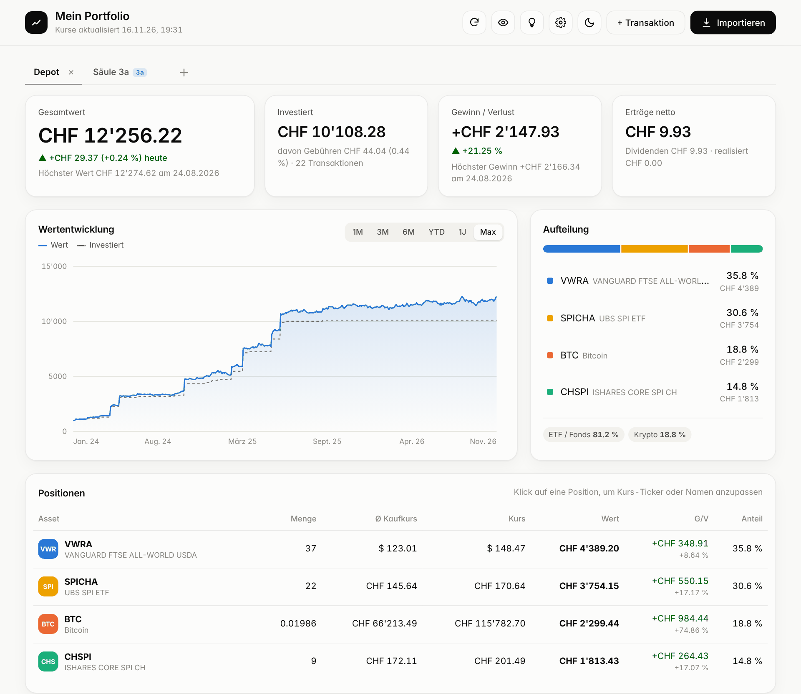
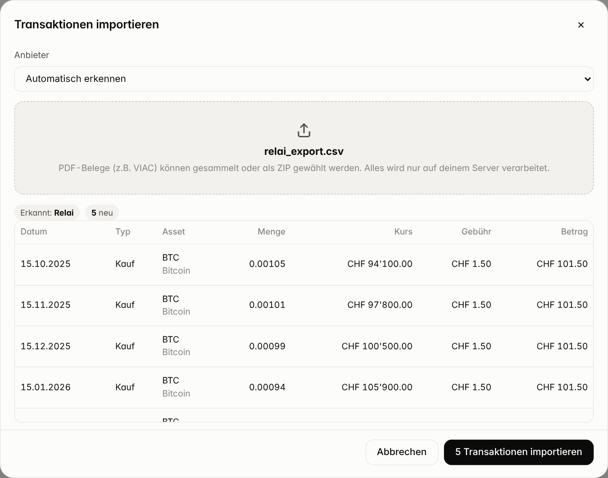
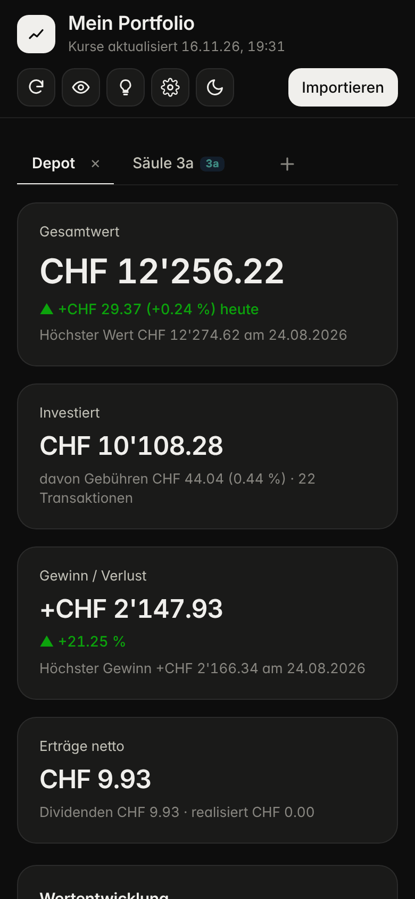
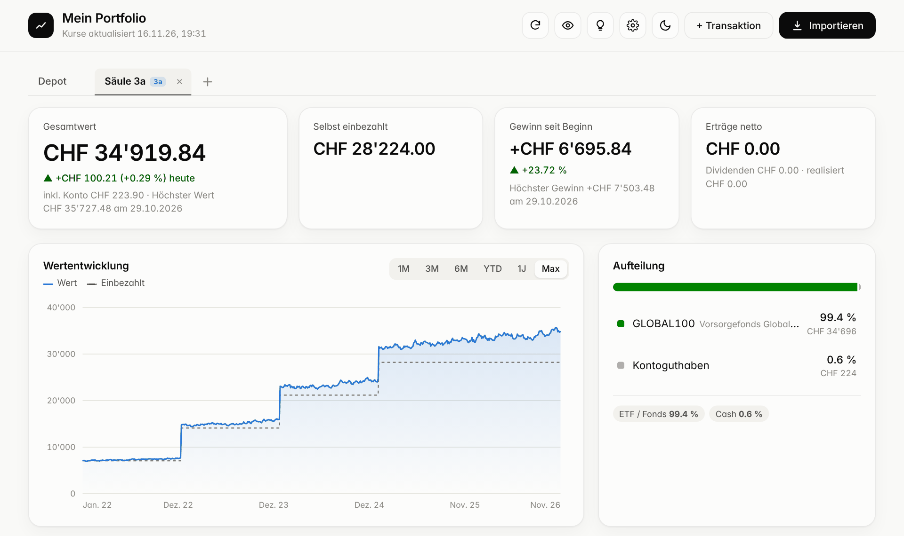
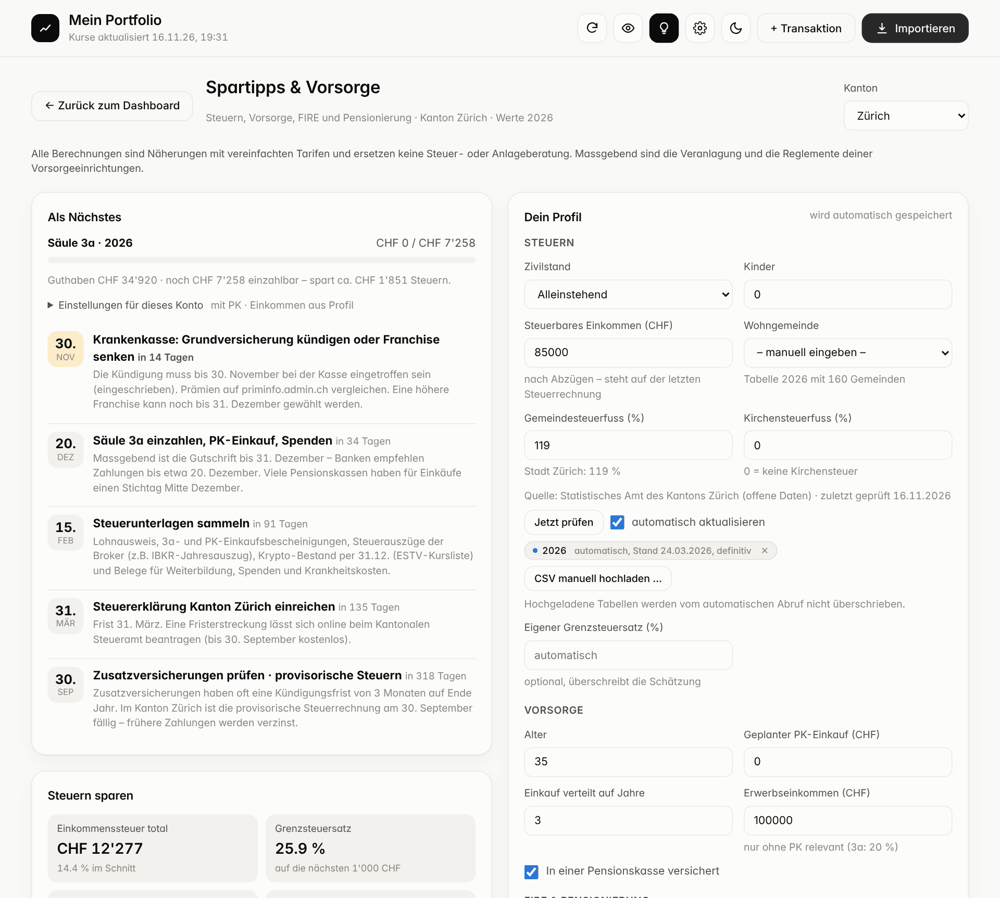
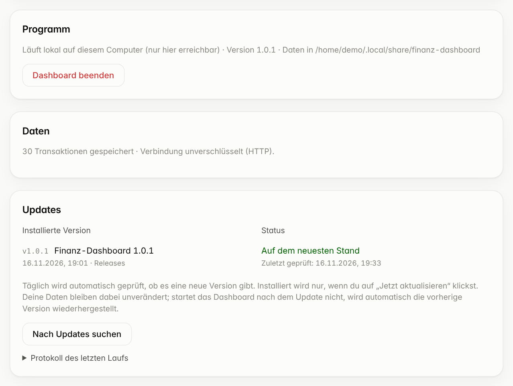

# Finance Dashboard

**English** | [Deutsch](README.de.md)

A lean, self-hosted portfolio dashboard – runs locally on your computer (Windows, macOS, Linux) or on your own
server / Proxmox homelab. Imports CSV exports from **Relai** (Bitcoin) and **Interactive Brokers** (ETFs/stocks),
plus any other CSV through column mapping, and PDF statements from Finpension and VIAC (Swiss pillar 3a).

- No external Python packages – just Python 3 and SQLite
- Live prices and exchange rates from Yahoo Finance (no API key), refreshed every 4 h
- Valuation in your base currency (default CHF), cost basis by the average-cost method
- Duplicate detection: the same file (or an IBKR statement plus a Flex Query) can be imported repeatedly
- Light/dark mode, works on phones too
- Savings tips & retirement: tax estimate, pillar 3a status, FIRE and pension calculators, deadlines (canton of Zurich)
- UI in German and English

More features are planned, e.g. imports from further brokers and 3a providers. Please report problems or wishes as an
[issue](https://github.com/Kevegl/finance-dashboard/issues), see [Problems & wishes](#problems--wishes).

> The UI and the tax/retirement features are tailored to Switzerland (CHF, pillar 3a, canton of Zurich). The portfolio
> part works with any base currency.

<picture>
  <source media="(prefers-color-scheme: dark)" srcset="docs/screenshots/dashboard-dunkel.png">
  
</picture>

<sub>All values in the images are made up (sample data from <code>beispiel-csv/</code>).</sub>

## How it works

1. **Download your exports** – transactions as CSV (Relai, Interactive Brokers, Finpension) or the PDF statements
   (VIAC). For other providers any CSV file works.
2. **Import** – drag the file into the dashboard. It recognises the provider, shows a preview and skips entries that
   already exist. Nothing is saved until you click *Import*.
3. **Keep the overview** – prices and exchange rates update automatically. At the top you see total value, money
   invested and profit, below that the development over time, the allocation and all positions –
   each with its price change over the last 24 hours in percent.

<table>
  <tr>
    <td width="62%" valign="top"></td>
    <td valign="top"></td>
  </tr>
  <tr>
    <td><b>Import:</b> provider is detected, preview before saving, duplicates are skipped.</td>
    <td><b>Phone:</b> adapts to small screens, light or dark.</td>
  </tr>
</table>

**Multiple portfolios and pillar 3a** – every account gets its own tab. For 3a accounts the dashboard works with the
payments made: *paid in by you* versus *total value*, including cash balance.



**Savings tips & retirement** (light bulb at the top right) – deadlines for the coming months, how much 3a payments
and pension-fund buy-ins save in taxes, municipality comparison, and a FIRE and pension calculator. The data in your
profile is stored only in your own dashboard.



**Settings → Program and updates** – shows the version and data folder, checks daily for new versions and installs
them with one click. If a new version does not start, the dashboard automatically returns to the previous one.



## Which variant suits me?

| You have …                                   | Recommendation                                               | Updates                         |
|----------------------------------------------|--------------------------------------------------------------|---------------------------------|
| a Windows PC or Mac, no wish to fiddle        | [**Download the program**](#program-windows--mac)            | one click in the dashboard      |
| Windows, Mac or Linux with Python            | [**Python variant**](#python-variant-windows-mac-linux)      | one click in the dashboard      |
| a NAS (Synology, QNAP), Raspberry Pi, Docker | [**Docker**](#docker-nas-raspberry-pi)                       | `docker compose pull`           |
| a Proxmox server / Linux server              | [**Proxmox (LXC)**](#installation-on-proxmox-lxc)            | one click in the dashboard      |

With the first two variants the dashboard only runs on your computer (`http://127.0.0.1:8765`) and is not reachable
from the network. They need no installation and no administrator rights. Server and Docker are also reachable from
your phone, at home or through a VPN.

## Program (Windows & Mac)

1. On GitHub under [**Releases**](https://github.com/Kevegl/finance-dashboard/releases/latest) download the matching
   file:
   - Windows: `FinanzDashboard-<version>-windows-x64.zip`
   - Mac with Apple silicon (M1 or newer): `FinanzDashboard-<version>-macos-arm64.zip`. For older Intel Macs use the
     [Python variant](#python-variant-windows-mac-linux).
2. Unzip the file, e.g. into *Documents* (Windows) or *Applications* (Mac).
3. **Start:**
   - Windows: double-click `FinanzDashboard.exe`. On first start Windows warns you («Windows protected your PC»)
     because the program is not signed with a paid certificate. Click *More info → Run anyway*.
   - Mac: start `FinanzDashboard.app` with *right-click → Open*. If only a warning appears instead:
     *System Settings → Privacy & Security → Open Anyway*. This is only needed the first time.
4. Your browser opens. On the first visit you choose a username and password.

While the dashboard runs, a small **status window** shows «Finance Dashboard – running on this computer» with the
buttons *Open in browser* and *Quit*. It stays in the taskbar or dock even if you close the browser, and can be
minimised. Closing the window quits the dashboard. You can also quit under *Settings → Program → Quit dashboard*.
If you launch the program again while it is running, it only opens the browser. Troubleshooting messages are in
`local/launcher.log` in the data folder (see below).

## Python variant (Windows, Mac, Linux)

1. Install **Python 3.10 or newer** if you do not have it yet:
   [python.org/downloads](https://www.python.org/downloads/). On Windows tick *Add python.exe to PATH*.
   On Linux Python is usually already installed.
2. On GitHub under [**Releases**](https://github.com/Kevegl/finance-dashboard/releases/latest) download *Source code
   (zip)* of the latest version and unzip it.
3. **Start** with a double-click:
   - Windows: `start.bat`
   - macOS: `start.command`. The first time use *right-click → Open*, because the file comes from the internet.
   - Linux: `./start.sh` in a terminal

   A console window, the small status window (as with the program, see above) and the browser open.
   On Linux the status window only appears if `python3-tk` is installed, otherwise only the console is shown.

**Quit:** *Quit* in the status window, *Settings → Program → Quit dashboard*, or `Ctrl+C` in the console window.

### Data, updates and password (program and Python variant)

**Your data** is stored separately from the program in your user profile. The program and the Python variant use the
same folder, so you can switch at any time:

| System  | Data folder |
|---------|-------------|
| Windows | `%LOCALAPPDATA%\FinanzDashboard` |
| macOS   | `~/Library/Application Support/FinanzDashboard` |
| Linux   | `~/.local/share/finanz-dashboard` |

You can delete or replace the program / download folder at any time, your data is kept.
Still, download a backup from time to time under *Settings → Backup*.
Use the environment variable `FD_DATA_DIR` to choose a different data folder and `FD_PORT` for a different port.

**Updates:** Once a day the dashboard asks GitHub whether a new version exists. A dot on the gear icon shows that an
update is available.
- It is installed only when you click under *Settings → Updates*. The dashboard downloads the new version into the
  data folder, restarts and checks that it runs. If it does not start, it automatically returns to the previous
  version. There is also a *Restore previous version* button.
- If you manually download a newer copy, that one is used automatically.

**Forgot your password?** Set a new one with your **recovery code** (see [Security](#security)): on the sign-in
page choose *Forgot password?*, or in the **status window** click *Forgot password …* → *With recovery code …*.

Without a recovery code you can only **start over**: status window → *Forgot password …* → *Start over – delete all
data …* and confirm by typing `DELETE` (German: `ENTFERNEN`). All portfolios, transactions and settings are deleted
permanently and an empty dashboard starts. This way nobody who sits at your unlocked computer can open your data with
a password of their own.

> Real protection against people with access to your computer comes from your computer account: lock the screen,
> use a Windows/macOS password or Windows Hello/Touch ID, and turn on disk encryption (BitLocker/FileVault).

## Docker (NAS, Raspberry Pi)

Ready-made image for amd64 and arm64 (Raspberry Pi 4/5, most NAS): `ghcr.io/kevegl/finance-dashboard`.
Download [`docker-compose.yml`](docker-compose.yml) and start it:

```bash
docker compose up -d
```

The dashboard is then available at `http://<address-of-the-device>:8080`. On a Synology NAS you can also use
*Container Manager → Project → Create* with this file. Data lives in the volume `fd-data`.
For the initial setup you need the **setup code** from the container log:
`docker logs finance-dashboard` (line «Einrichtungscode für die Ersteinrichtung: XXXX-XXXX», the server log is in German).

**Updates:** *Settings → Updates* shows when a new version exists. Install it with:

```bash
docker compose pull && docker compose up -d
```

Or automatically with [Watchtower](https://containrrr.dev/watchtower/).

Docker runs without HTTPS. Make it reachable only in your home network or through a VPN and do not set up port
forwarding on your router. Forgot your password: on the sign-in page with the recovery code (see
[Security](#security)) or, without a code, with:

```bash
docker exec finance-dashboard python3 server.py --reset-password
```

## Installation on Proxmox (LXC)

1. **Create the container** (on the Proxmox host, Debian 12 template):
   ```bash
   pveam update && pveam download local debian-12-standard_12.7-1_amd64.tar.zst
   ID=120   # a free container ID on your Proxmox host
   pct create $ID local:vztmpl/debian-12-standard_12.7-1_amd64.tar.zst \
     --hostname finance --cores 1 --memory 512 --rootfs local-lvm:4 \
     --net0 name=eth0,bridge=vmbr0,ip=dhcp --unprivileged 1 --features nesting=1 --start 1
   ```
   (Adjust ID, storage and template version to your system – `pveam available | grep debian` shows the current version.)

2. **Fetch the code** and install (inside the container):
   ```bash
   pct enter $ID
   apt update && apt install -y git
   git clone https://github.com/Kevegl/finance-dashboard.git /root/finance-dashboard
   cd /root/finance-dashboard && bash install.sh
   ```

3. Open in your browser: `https://<container-IP>:8080` (confirm the certificate warning once)

### Settings
In `/etc/finance-dashboard.env`, then `systemctl restart finance-dashboard`:

| Variable | Meaning | Default |
|---|---|---|
| `FD_PORT` | Port | `8080` |
| `FD_BASE_CCY` | Initial base currency (can be changed later in the settings) | `CHF` |
| `FD_PRICE_TTL` | Price refresh interval in seconds | `14400` |

**Security:** `install.sh` automatically enables **HTTPS** (self-signed certificate). On the **first visit** you
choose a username and password in the browser; this requires the **setup code** that `install.sh` prints at the end
(also in `/var/lib/finance-dashboard/setup-code.txt` and `journalctl -u finance-dashboard`). The password is stored
as a PBKDF2 hash, sign-in uses a secure session cookie valid for 30 days. Changing the password, signing out other
devices and CSV export are under **Settings** (gear at the top right). After 5 wrong passwords the IP is blocked for
15 minutes.
Forgot your password: on the sign-in page with the recovery code. Without a code, in the container run
`cd /opt/finance-dashboard/app && FD_DATA_DIR=/var/lib/finance-dashboard python3 server.py --reset-password`;
the initial setup then appears again. Further protections are described under [Security](#security).
Make it reachable from outside only through a VPN (WireGuard/Tailscale), no port forwarding on your router.

**Backup:** Under *Settings → Backup & restore* you download a JSON file with all portfolios, transactions, ticker
settings and the price history (without the password). After a reinstall: set up your login → restore the backup.
Also recommended: include the container in your Proxmox backup job.

**Multiple portfolios:** Use the tabs at the top of the dashboard (+ = new portfolio, double-click = rename). Each
portfolio has its own transactions and imports; manage/delete them under *Settings → Portfolios*.

**Update:** easiest in the dashboard under *Settings → Updates* (see below). Alternatively in the container:
`cd /root/finance-dashboard && git pull && bash install.sh` (data and settings are kept – they live outside the repo
in `/var/lib/finance-dashboard` and `/etc/finance-dashboard.env`).

## Updates in the dashboard (Proxmox)

If the dashboard was installed via `git clone`, `install.sh` also sets up a small update service. Under
*Settings → Updates* you then see the installed version and whether a new one exists (with a change list), and can
install it with one click. A dot on the gear icon shows that an update is available.

- **Daily check:** A systemd timer checks once a day whether a new version exists. Installation only happens on click.
- **Channel** (`FD_UPDATE_CHANNEL` in `/etc/finance-dashboard.env`): `release` offers only published versions (git
  tags `v1.2.3`). This is the default for new installations. With `main` every new commit is an update. Without an
  entry `main` applies, so existing installations behave as before.
- **Security:** The dashboard runs as a restricted user and only writes a job file when you click. The job is executed
  by the root service `finance-dashboard-update`, which accepts only `check`, `update` and `rollback`, only fetches
  fast-forward updates from its own repository and never overwrites local changes.
- **Signature check (recommended):** Because `install.sh` runs as root during an update, a foreign push to GitHub
  (stolen account or token) could execute code in the container. With a list of allowed keys the service installs
  only versions signed with your own SSH key – see [Signed updates](#signed-updates).
- **Automatic rollback:** If the dashboard does not respond after the update, the previous version is restored.
  There is also a *Restore previous version* button.
- By hand in the container: `finance-dashboard-update check | update | rollback`, status in
  `/var/lib/finance-dashboard-update/status.json`, timer: `systemctl list-timers finance-dashboard-update-check.timer`.

### Signed updates

Once, on your own computer, create a signing key and tell Git to sign tags with it:

```bash
ssh-keygen -t ed25519 -f ~/.ssh/finance_release -C "finance-dashboard release"
```

```bash
git config --global gpg.format ssh && git config --global user.signingkey ~/.ssh/finance_release.pub
```

In the container create the file `/etc/finance-dashboard/allowed_signers` (one line per allowed key, insert the
content of `~/.ssh/finance_release.pub`) and set the channel to `release`:

```bash
echo 'release namespaces="git" ssh-ed25519 AAAA…your-public-key…' > /etc/finance-dashboard/allowed_signers
```

```bash
sed -i 's/^FD_UPDATE_CHANNEL=.*/FD_UPDATE_CHANNEL=release/' /etc/finance-dashboard.env && grep -q '^FD_UPDATE_CHANNEL=' /etc/finance-dashboard.env || echo 'FD_UPDATE_CHANNEL=release' >> /etc/finance-dashboard.env
```

From then on the update service installs only releases whose tag is signed with this key
(`git tag -s v1.2.3 -m "…"`, see [Publishing a new version](#publishing-a-new-version)). *Settings → Updates* shows
an unsigned release as «Cannot be installed». On the `main` channel the latest commit must be signed accordingly.
Without the file the check stays off (previous behaviour). Different path:
`FD_UPDATE_SIGNERS=/path/to/file` in `/etc/finance-dashboard.env`.

Note: The check applies to the Proxmox installation with the update service. The program, the Python variant and
Docker download releases directly from GitHub over HTTPS.

**Private repository** (only for your own private fork): the container needs read access, ideally a deploy key:
```bash
ssh-keygen -t ed25519 -f ~/.ssh/finance_deploy -N "" -C "finance-lxc"
printf 'Host github.com\n  IdentityFile ~/.ssh/finance_deploy\n  IdentitiesOnly yes\n' >> ~/.ssh/config
cat ~/.ssh/finance_deploy.pub   # on GitHub: Repo → Settings → Deploy keys → Add (without write access)
git clone git@github.com:Kevegl/finance-dashboard.git /root/finance-dashboard
```

## Exporting CSV

**Relai:** app → *Transactions* → arrow at the top right → choose period → format *CSV*.
Buys and sells are imported; withdrawals to your own wallet are skipped (the BTC is still yours).

**Interactive Brokers** – two variants, both detected automatically:
- *Activity Statement*: Client Portal → Performance & Reports → Statements → *Activity* → choose period → format
  **CSV**. Also contains dividends and the exchange (for automatic price tickers).
- *Flex Query*: Performance & Reports → Flex Queries → Activity Flex Query with the section *Trades* (fields incl.
  Symbol, TradeDate, Quantity, TradePrice, CurrencyPrimary, IBCommission, Buy/Sell, ListingExchange) → format CSV.

Tip: at IBKR export the statement for a whole year or since account opening. Currency-exchange trades (e.g. CHF→USD)
are skipped.

**Other providers** (Swissquote, PostFinance, Yuh, …): in the import dialog choose *Other provider* and map the
columns (date, asset, quantity, price, amount …).

## Prices & tickers
On import the Yahoo ticker is set automatically where possible (BTC → `BTC-CHF`, IBKR with exchange LSE →
`VWRA.L`, SIX → `CHSPI.SW` …). If a ticker is missing, the position is valued at the last purchase price – a notice
appears at the top. Click the position to set the ticker or enter a manual price.
Suffixes: `.SW` SIX, `.L` London, `.DE` Xetra, `.AS` Amsterdam, `.PA` Paris, no suffix = USA.

The server needs internet access to `query1.finance.yahoo.com` for this.

## Pillar 3a: Finpension and VIAC

- **Finpension:** export the transaction report as CSV and import it (detected automatically).
- **VIAC:** offers no CSV export – import the PDF statements instead (several PDFs at once or as a ZIP).
  Recognised are trade confirmations (buy/sell), distributions, interest and management fees.
- Deposits/withdrawals and transfers between foundations are pure cash movements and are skipped.
- Interest and account fees go through the position “CASH” and flow into “Net income”.
- The funds usually have no Yahoo price – they are valued at the last buy/sell price (quite current with monthly
  purchases) or a manual price (click the position).
- PDF import needs `pdftotext` (package `poppler-utils`, installed by install.sh).

## Savings tips & retirement

The light bulb icon at the top (or `#/vorsorge`) opens a dedicated view:

- **Up next:** upcoming deadlines by date (health insurance 30 Nov, 3a / pension-fund buy-in until year end, tax
  return …) and how much you can still pay into pillar 3a this year – the payments in your 3a portfolios are counted.
- **Save taxes:** estimate of income tax, marginal rate and savings from a 3a payment, a 3a catch-up payment and a
  pension-fund buy-in (one-off vs. staggered). You can enter the marginal rate from your own tax bill directly.
- **Municipal tax rates:** for the canton of Zurich the server fetches the current rates automatically (at most once a
  day) from the open data of the Statistical Office (`www.web.statistik.zh.ch`, dataset «Steuerfüsse der Zürcher
  Gemeinden» on opendata.swiss). New years appear as soon as the canton publishes them; in the profile the fetch can
  be triggered or switched off. Alternatively upload the CSV manually (the year is read from the file name; uploaded
  tables are not overwritten by the fetch). Then choose your municipality and denomination; municipalities with
  several rates (school/church municipalities) offer a choice of variants. There is also a comparison with the
  cheapest and most expensive municipalities.
- **Multiple 3a accounts:** e.g. show or compare your own and your partner's account separately; per account you can
  set pension-fund affiliation, earned income and taxable income.
- **FIRE & retirement:** FIRE number, earliest exit age, bridge to 65 including AHV contributions as a non-employed
  person, and pension gap. Wealth is taken from your portfolios (can be overridden).
- **Tips & tricks:** about 45 tips on taxes, retirement provision, investing, everyday life, FIRE, retirement and
  upcoming law changes – with personal figures from your profile and tick-off boxes.

**New year:** 3a payments and deadlines always refer to the current year. Annual tips (3a, health insurance,
deductions …) reopen on 1 January, one-off ones stay done; time-limited tips disappear after their year of validity.
Official yearly values (maximum AHV pension, 3a maximum, federal tariff) are in `YEAR_VALUES`/`FED_BY_YEAR` in
`app/static/plan.js` and arrive via updates. If they are missing for a new year, the previous year's values apply with
a notice – there you can enter the new maximum AHV pension; the 3a maximum amounts (24 % and 120 % of the annual
maximum pension) are calculated from it.

The profile is stored on the server (in the database, so it is part of the backup). All tariffs are approximations
(federal tax per the official 2026 tariff, cantonal tax simplified) and are not advice. Further cantons can be added
in `app/static/plan.js` (`CANTONS`, `DEADLINES`, `TIPS` with `canton`).

## Language & news ticker

- **Language:** German or English under *Settings → General*. Applies to the whole dashboard and the news.
- **News ticker:** a scrolling line above the portfolio tabs with current headlines (Google News, last 14 days) about
  the positions held in the open portfolio. The server fetches the items and caches them for 30 minutes; the browser
  never connects to Google directly. Can be switched off in the settings.
- The search term can be customised per position: click the position → *News search term* (empty = name of the
  position).
- **Pillar 3a:** pension funds never make headlines. In 3a portfolios the ticker therefore maps the funds to their
  market (e.g. SMI, world markets, Wall Street, emerging markets, Swiss real estate, SNB interest rates, gold) and
  additionally shows news about the provider (VIAC, Finpension) and pillar 3a in general. A position's own news search
  term takes precedence.

## Problems & wishes

**Something does not work?** Open an [issue on GitHub](https://github.com/Kevegl/finance-dashboard/issues/new) and
briefly describe:
- which variant you use (program for Windows/Mac, Python variant, Docker or Proxmox) and the version
  (*Settings → Updates*),
- what you did, what happened and what you expected,
- the error message or a screenshot.

> **Please do not attach real financial data**: no own CSV/PDF exports, backups, account numbers or screenshots with
> real amounts. Issues are public. Replace values with made-up ones or black them out.
> For an import problem, two or three lines of the file with changed numbers are enough.

**Planned:** more features, e.g. imports from further brokers and 3a providers. Wishes are welcome as an issue, ideally
with a sample file containing made-up values.

## Development & tests

```bash
cd app && python3 server.py      # server mode, http://localhost:8080, data in data/
python3 app/launcher.py          # local mode as with a double-click, http://127.0.0.1:8765
python3 tests/smoke_server.py    # quick test of server mode incl. import of all sample CSVs
python3 tests/calc_unit.py       # unit tests: numbers, dates, calculation, login lockout, setup code
python3 tests/update_verify.py   # signature check of the update service (git + ssh-keygen)
python3 tests/smoke_local.py     # quick test of local mode (start, sign-in, second instance, quit)
```

The folder `beispiel-csv/` contains test files for all formats (made-up values).

**Server structure** (`app/`, Python standard library only):

| File | Contents |
|---|---|
| `server.py` | HTTP: routing tables `GET_ROUTES`/`POST_ROUTES`, login protection, startup |
| `config.py` | Environment variables and constants; `config.BASE` = current base currency |
| `store.py` | SQLite: `db_tx()` (transaction, closes the connection), schema/migrations, settings, backup |
| `validate.py` | Validation of date, numbers and type of a transaction |
| `auth.py` | Password hash, sessions, two-factor, recovery code, sign-in log |
| `portfolio.py` | Calculation: holdings, cost basis, income, history |
| `prices.py`, `news.py`, `muni.py` | Prices/exchange rates, news ticker, municipal tax rates (external requests) |
| `importers.py`, `uploads.py` | Provider CSV formats, PDF/ZIP upload |
| `updates.py`, `local_update.py`, `launcher.py` | Updates (root service, releases), local mode |

**Regenerating the README screenshots:** `python3 docs/screenshots/demo_data.py /tmp/fd-demo` creates a demo
dashboard with made-up values and prices. Then start the server with it
(`FD_DATA_DIR=/tmp/fd-demo FD_PRICE_TTL=999999999 python3 app/server.py`) and run
`node docs/screenshots/shoot.js http://127.0.0.1:8080 docs/screenshots <import-CSV>` (Playwright required).
For the settings image also start the server with `FD_LOCAL=1` and call `shoot.js` with `local`. GitHub Actions runs
the quick tests on every push on Windows, macOS and Linux (`.github/workflows/tests.yml`), including the start
scripts and the Docker image.

### Publishing a new version

1. Raise the version number in `app/VERSION`, e.g. to `1.1.0`, commit and push.
2. On GitHub under *Releases → Draft a new release* create the tag `v1.1.0` (must match `app/VERSION`), briefly
   describe the changes and click *Publish release*.
   Alternatively in a terminal: `git tag -a v1.1.0 -m "Changes …" && git push origin v1.1.0`. The tag message becomes
   the release notes; the workflow creates the release itself. With [signed updates](#signed-updates) create the tag
   with `git tag -s` instead of `-a` on your own computer – an unsigned release will not be installed by the update
   service.
3. The workflow `.github/workflows/release.yml` then builds automatically:
   - the Docker image `ghcr.io/kevegl/finance-dashboard:1.1.0` and `:latest`,
   - the Windows `.exe` and the Mac app, tests both and attaches them to the release.

   For the very first image the package must be made public once: GitHub → *Packages* → `finance-dashboard` →
   *Package settings* → *Change visibility* → *Public*.

All installations on the «Releases» channel (program, Python variant, Docker notice and new Proxmox installations)
see the new version within a day. With *Run workflow* the release workflow can also be tested without publishing.
The built files are then available as artifacts of the run.

## Security

**Sign-in** (all variants)
- You choose username and password on the first visit. The password is stored only as a PBKDF2 hash.
  After 5 failed attempts sign-in from that address is blocked for 15 minutes, even with many simultaneous requests.
- **Setup code** (server and Docker): as long as no password is set, the initial setup requires a one-time code. This
  way nobody on the network can take over a fresh installation before you. The code is in the output of
  `install.sh`, in the log (`journalctl -u finance-dashboard` or `docker logs`) and in `setup-code.txt` in the data
  folder. It is deleted after setup; after `--reset-password` there is a new one. In local mode (program/`start.*`,
  reachable only from this computer) no code is needed. Instead the local dashboard only answers requests addressed to
  `127.0.0.1` or `localhost`, so a web page cannot reach it under its own domain name (DNS rebinding).
- **Recovery code:** after setup the dashboard shows a code like `K7Q2M-…` once. Keep it separate from your password,
  e.g. in a password manager or printed. With it you set a new password on the sign-in page under *Forgot password?*,
  without any commands. A new code is issued immediately afterwards. Existing installations generate their code under
  *Settings → Recovery code*.
- **Two-factor sign-in (optional):** switch it on under *Settings → Two-factor sign-in* and scan the QR code with an
  authenticator app (e.g. Google Authenticator, Microsoft Authenticator, 1Password, Bitwarden). Alternatively type
  the key in by hand. On a phone the link *Open in authenticator app* opens the app directly. After that sign-in
  additionally needs the 6-digit code. Lost your phone? The recovery code switches two-factor sign-in off.
- **Sign-in log:** *Settings → Sessions* shows the last sign-in, the failed attempts of the last 30 days and a log
  with time and address. On the server the events are also in the system log (`journalctl -u finance-dashboard`).
- Sessions expire after 30 days. Under *Settings → Sessions* you can sign out all other devices. Changing the
  password signs them out automatically.

**Server installation (Proxmox/LXC)**
- HTTPS with an automatically renewed certificate. The dashboard runs as its own user without special privileges,
  heavily restricted by systemd: it may only write to its data folder, has no access to devices, kernel settings or
  other processes and may only use the necessary system calls. If the service does not start in a container with the
  full restrictions, `install.sh` relaxes only the container-dependent options and reports it.
- **Automatic security updates:** `install.sh` sets up `unattended-upgrades`. Debian then installs security updates,
  e.g. for Python and OpenSSL, by itself every day. Affected services are restarted afterwards.
  To switch off: set both values in `/etc/apt/apt.conf.d/20auto-upgrades` to `"0"`.
- Dashboard updates run through a separate service, see [Updates in the dashboard](#updates-in-the-dashboard-proxmox).
- Make it reachable from outside only through a VPN (WireGuard/Tailscale), no port forwarding on your router.

**Local and Docker:** locally the dashboard is reachable only from your own computer (`127.0.0.1`).
Docker runs without HTTPS and therefore belongs only in your home network or behind a VPN. Current system libraries
arrive there with every new image.

## Privacy
Your financial data stays on your device or server. There is no user account, no cloud and no telemetry. The dashboard
connects only to these services, always from the server and never directly from the browser:

| Service | Purpose | What is sent |
|---|---|---|
| Yahoo Finance | Prices and exchange rates | Ticker symbols of your positions |
| Google News | News ticker (can be switched off in the settings) | Search terms for your positions |
| Statistical Office of the canton of Zurich | Municipal tax rates (savings tips) | nothing personal (open data) |
| GitHub | Daily check for new versions, download of updates | nothing personal |

Quantities, amounts and transactions never leave the device.

The repository contains only code and made-up sample data. Database, backups, your own CSV/PDF exports, `.env` files
and certificates are excluded via `.gitignore`. When tested locally the database ends up in `data/` (also ignored).
